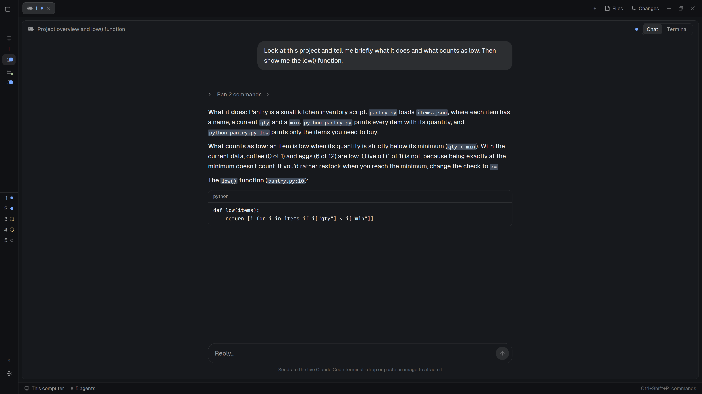

# Herdr Chat

Any Claude Code, Codex or Pi terminal, shown as a chat. A Chat / Terminal toggle in the top-right
of the pane header swaps one for the other in place; the agent keeps running in its terminal either
way. The chat reads the agent's own session log, so it also works for agents on other machines
herdr reaches.



## Install

This repository is laid out like the herdr home (`~/.config/herdr-app`):

1. Copy `mods/herdr-chat/` to `~/.config/herdr-app/mods/herdr-chat/`.
2. Copy `layouts/herdr-chat.json` to `~/.config/herdr-app/layouts/herdr-chat.json`.
3. Switch to it: `herdr-app do layout.switch --name herdr-chat` (or `ctrl-shift-l`). Your own layout
   stays as it was; switch back the same way.

Without the layout the chat panel still loads but has nothing to swap with and no toggle: the
in-place swap lives in the layout (see Built from).

## What you see

The layout is herdr's shipped `main` layout (Spaces and Agents on the left, tab pills, Files and
Changes panels, status bar) with one change: the work area is a `chat-view` stack of two children,
the chat and the live terminal.

- **Terminal view.** The terminal pane has a 42 px header: the program's icon, its name, its
  folder, then on hover split right, split down, zoom and close, then the agent's status (a
  spinner while working, a "Needs you" badge while blocked, a dot when finished unseen), and at the
  far right the **Chat | Terminal** toggle with Terminal selected. Every session starts here.
- **Chat view.** The same 42 px header, then a centred column 740 px wide:
  - your messages as rounded bubbles on the right; the agent's replies as plain text on the left,
    rendered as markdown with fenced code blocks;
  - tools and thinking folded into one grey line per run, like "Ran 3 commands, read 2 files ›";
    clicking it lists each step with its command or file name and up to six lines of output;
  - 28 px of extra space where you and the agent take turns;
  - at the bottom, while the agent works, an accent-coloured spark and its live status message;
  - messages fade out over the last 20 px above the reply area as they scroll under it, and the
    newest message has 32 px of room below it;
  - a rounded reply box that grows from one to four lines as you type, with a round send button in
    the theme's accent, and a line under it saying which terminal it sends to; attached images sit
    above the text as 64 px thumbnails, each with a remove button;
  - a round "jump to bottom" button when the newest message is off screen.
- **Empty chat.** Herdr's own logo (`frame/welcome/herdr.png`) with a message: "Opening this Pi
  conversation…" (the logo pulses), "Waiting for this … conversation to start.", or "No messages in
  this session yet." (it holds still).

All colours come from the active theme (`theme()`), so the chat matches whichever theme or layout it
runs in. Icons are the mod's own SVGs drawn in the theme's text colour.

## How it behaves

- **Which agents.** Terminals whose program reports itself as `claude-code`, `codex` or `pi`. Other
  tabs have no toggle and always show the terminal.
- **Which view.** Every session starts in the terminal. Clicking Chat switches that session, and it
  stays in the chat, also after a restart, until switched back. A session is the agent's terminal
  address plus its start time; the latest 200 are remembered (shared key `herdr-chat.views`).
  Moving to another tab or agent shows that session's remembered view.
- **↑ and ↓ in the reply box.** The line above or below at the same column (a run of them keeps the
  column it started from), the start on the first line, the end on the last. Lines are those between
  line breaks: a long line that wraps counts as one. Shift+↑/↓ keep the textarea's own selection.
- **Sending.** Enter sends, Shift+Enter is a new line; Enter never leaves a new line in the box
  (the textarea's own one is taken out again). The box empties at once, and a send that fails puts
  the text and images back. The text is typed into the agent's live
  terminal with `hc send`, from the agent's own machine and without hc's terminal identity, so it
  arrives as plain typing rather than wrapped in `<hc from="…">`. Sending to a terminal that is
  waiting on a question needs `--force`; the chat only does that after checking the question on
  screen hasn't changed since it was shown.
- **Images.** Drop image files (png, jpg, gif, webp) anywhere on the chat, or press Ctrl+V with an
  image on the clipboard (wl-paste, xclip or pngpaste; PowerShell on Windows). Each is shrunk to a
  JPEG under 240 KB when it's bigger (Claude Code drops an @-mentioned image over about 256 KB),
  kept as a preview copy in `~/.config/herdr-app/cache/herdr-chat/` until it's sent or removed
  (`image()` draws only from the herdr home), and sent with `hc put` beside the agent's terminal,
  here or on another machine, in a folder herdr-core removes with the terminal. The message carries
  it the way each agent attaches an image itself: Claude Code an `@path` mention; Codex the path
  pasted alone first (it makes `[Image #N]` of that), then the text; Pi the plain path, as its own
  Ctrl+V leaves (its model opens it with `read`).
- **One draft.** The chat box and the agent's own input box hold the same draft. Switching a
  session to Terminal types the chat's draft, images included, into the agent's box without
  sending it (an empty draft empties the box); switching back reads the box into the chat, turning
  the chat's own image entries back into thumbnails and a long paste's placeholder (`[Pasted text
  #1 +7 lines]`) back into its text. An image pasted in the terminal itself stays there with a note:
  the agent keeps it where the chat can't read it. A chat send empties the agent's box first.
  Switching to Chat puts the keyboard in the reply box.
- **Diagrams.** A reply's ```` ```mermaid ```` block shows as a picture right in the reply, drawn by
  [Pele](https://github.com/obsidianmd/pele) in the theme's colors and scaled to the column, with no
  frame around it. While it draws, a "Drawing diagram…" line stands in; when Pele can't parse it, its
  source shows as a code block with the reason. Ten types are included: flowchart, sequence, state,
  class, ER, Gantt, pie, mindmap, timeline and git graph.
- **Questions.** When an agent is blocked the chat shows "<Agent> needs your input" with the last
  twelve lines of its screen and ↑ ↓ Enter Esc buttons (sent as keys through `hc keys`) and an Open
  terminal button. Each key is only sent if the screen still shows the same question.
- **Reading.** The agent's session file is found once per session and remembered (shared key
  `herdr-chat.paths`). The first read takes the last 24 MB of the file (at most the last 400
  entries); later reads return only the lines added since. On this computer a change to the file
  wakes the chat (`watchFolder`), with a re-read every 15 s as a safety net; for an agent on another
  machine it polls every 1.5 s.
- **Switching.** Picked up within 100 ms. The twelve most recent conversations stay in memory, so
  switching back is instant and reads only what's new.
- **Following.** The chat stays at the bottom while you're at the bottom; scrolling up stops it and
  shows the jump button. Opening the chat, sending, or the jump button goes back to the bottom.
- **Highlight.** Selected text in the chat and in herdr's built-in text boxes is drawn in a dimmed
  version of the theme's accent instead of the near-invisible gray herdr derives from the hover
  colour (see Watch out).

## Built from

Layout (`layouts/herdr-chat.json`): `main.json` with its `main` block replaced by

```
chat-view   stack, active "terminal-panel"
  chat-panel      block  { mod: "herdr-chat", props: { role: "chat" } }
  terminal-panel  block  { tab: "active", pane: { ...main's pane look,
                           header: { content: { mod: "herdr-chat" }, height: 42,
                                     position: "top", reveal: "always" } } }
```

A mod can't place a live terminal, so the swap is the layout's `layout.select { stack: "chat-view",
child: … }`. The same mod is therefore used twice: as the chat panel and as the terminal pane's
header; `props()` tells the two copies apart (a header copy gets `{ pane, terminal }`).

Mod (`mods/herdr-chat/`, `mod.json` is `{"place":"none"}`):

| File | Role |
|---|---|
| `main.js` | the chat View: its state and timers, the layout, scrolling, sending |
| `reading.js` | reading conversations: the one shown, every other agent's in the background, switching, the loading row's rules (mixed in) |
| `session.js` | a session's state, the reader's output applied to it, the batch run for one machine's agents (pure) |
| `transcript.js` | conversation rows: folding tool calls and thinking, row keys, drawing each kind |
| `choices.js` | a question card, choosing a choice, the key buttons (mixed into the View) |
| `prompts.js` | `parseChoices`: a choice prompt read off the screen (pure) |
| `images.js` | attaching images, their preview copies, placing them beside a terminal (mixed in) |
| `draft.js` | one draft per session, mirrored into the agent's own input box (mixed in) |
| `agents.js` | one profile per agent: how a message carries images, how its box shows the draft |
| `terminal.js` | the target agent, reading its screen, sending as the person, keys, `input-box.py` |
| `platform.js` | Windows and Unix differences: paths, quoting, base64, deleting files |
| `diagrams.js` | mermaid diagrams: Pele's SVG with the theme's colors and font lists written in, drawn one per tick |
| `vendor/pele/` | Pele, copied by `scripts/vendor-pele.mjs` from the version `package.json` pins (don't edit) |
| `ui.js` | shared look: column width, icons, program icon, pane buttons, status badge, view toggle, clock time |
| `header.js` | the terminal pane header with the toggle |
| `common.js` | session keys, per-session view memory, `layout.select` |
| `read-session.ps1` | session reader on Windows (PowerShell 5.1) |
| `read_session.py` | the same reader for Linux, macOS and other machines (Python 3.6+) |
| `send.ps1` | sends text on Windows without hc's terminal identity |
| `prepare-image.sh` / `prepare-image.ps1` | copy an image (or the clipboard's) into the preview folder, shrunk under 240 KB |
| `input-box.py` | reads, sets or pastes into an agent's own input box without Enter, through `hc attach` in a pty (the one draft, Codex images) |
| `icons/` | the mod's own SVG icons |

Herdr functions used: `agents()`, `terminals()`, `panes()`, `focused()`, `props()`, `theme()`,
`settings()`, `shared()` / `setShared()`, `hc()`, `exec()`, `appHome()`, `watchFolder()`,
`run("layout.select" | "pane.split" | "pane.zoom" | "pane.close" | "pane.focus")`, and `cx.theme()`
with `set_theme` from `gpui-base`. UI parts: `v_virtual_list` with a `VirtualListScrollHandle`,
`TextareaState` / `Textarea`, `TextView.markdown`, `.loop()` and `.frames()` for animation.

## Watch out

**Before adding it, tell the person what it does** (herdr's rule for shared mods). This mod:

- runs programs: `powershell.exe` (Windows), `python3`, `sh`, `env`, `hc` (also `hc attach`,
  `hc put`), `wl-paste` / `xclip` / `pngpaste` and ImageMagick (`magick`) or `sips`, including on other
  machines through `exec(…, { on: machine })`; the Python reader is passed to `python3 -c`, so
  nothing is installed on the other machine, but `python3` and `hc` must be there;
- reads files outside its own folder: the agents' session logs under `~/.claude/projects`,
  `~/.claude/sessions`, `~/.codex/sessions` and `~/.pi/agent/sessions`, and reads the terminal's
  screen with `hc read`;
- types into terminals (`hc send`, `hc keys`, and pastes and Delete/Backspace through `hc attach`);
- writes image copies under `~/.config/herdr-app/cache/herdr-chat/` (removed once sent or after a day);
- changes one colour in herdr's shared palette for the whole app while it runs: `set_theme` with
  the palette's `accent` (and `selection`) set to a dimmed version of the theme's accent. It's the
  only way to make selected text visible in herdr's built-in text boxes; it follows the theme and
  is re-applied if herdr resets it. It does not touch the theme files.

It does not use the network.

Things a fresh build would get wrong:

- **Diagrams need real colors.** Pele colors its SVG through CSS variables and herdr's SVG renderer
  has no stylesheet: shapes come out black and text is missing. Write the theme's colors into the
  SVG (each `--_x` Pele defines on its root, and series colors used as `var(--pele-series-N,…)`).
- **Nothing clickable inside a list row.** A handler registered in `v_virtual_list`'s item renderer
  throws; the list's `on_item_click` gets a row's key. A diagram is a row of its own (its reply is
  split around it), so it's measured on its own and again once drawn.
- **↑/↓ never reach a handler outside the textarea**, not even at its first or last line, and it can
  neither say where its cursor is nor be asked to move it by action name (`dispatch_action` reaches
  only handlers a script registered). So the chat binds `up`/`down` in context
  `HerdrChatReply > Input` (the textarea's context is `Input`) to its own actions, reads the cursor
  by typing an invisible marker at it with `replace()` and putting the text back (`caret.js`), and
  moves it with `set_selected_range`. Bind once per engine: the keymap is the app's.
- **Scrolling a virtual list to the bottom takes a frame or more.** `scroll_to_bottom()` lines up
  the last row's *top* with the view's (so the list ends with a short spacer row, or a long last
  message shows from its start), applies in a later frame, and its first call after a switch can
  fall short. A switch is done in the frame that first sees the new agent (`switchSession`, from
  `render`), scrolls there, and keeps the list hidden until the list reports its spacer on screen
  (`visibleEnd`), scrolling again meanwhile. `render` can't `notify()`, but its `cx.timer` works.
- **Every agent's chat is kept read in the background.** Every 4 s, `warm()` (reading.js) reads each listed
  agent's log from where it last stopped, all of a machine's agents in one Python run
  (`batchProgram` in session.js runs the reader once per session and separates their output), so a
  switch shows the conversation at once. The chat shows once its bottom screenful is measured; older
  rows are measured after. A slow read of a stale conversation shows "Checking for new messages…"
  after 300 ms, and after 5 s (or a failed read) "<machine> isn't answering", with Retry.
- **A Codex terminal's log isn't always the one started with it.** `codex resume <id>` goes on in
  that session's own logs, started days before the terminal, and Codex continues a long session in
  `rollout-<time>-<id>_<part>.jsonl`; the reader takes the id from the command line and opens the
  newest part. "Approve for me" runs a reviewer that writes its own logs in the same folder, marked
  `source: {"subagent": ...}`: never read one, even when the chat remembers it.
- **Messages sent while Claude Code works aren't "user" entries.** Claude logs a steer as an
  `attachment` of type `queued_command` (its text in `prompt`) in the conversation chain, so the
  reader shows those too (human origin, prompt mode). Codex and Pi log a steer as an ordinary user
  message.
- **Pele is copied, not installed.** A mod imports only from its own folder and herdr has no npm,
  so `vendor/pele/` is committed; `npm install && npm run vendor:pele` updates it from the pin and
  `node scripts/vendor-pele.mjs --check` tells whether it matches.

- **Pasting without Enter.** `hc send` always presses Enter and `hc keys` takes only named keys, so
  a paste that waits (an image path for Codex, the mirrored draft) goes through `hc attach` in a
  pty at the terminal's own size, as one bracketed paste, then ctrl+\ to detach. `hc attach` asks
  the terminal for its colours, cell size and device attributes before its first paint: answer them
  or every look waits about a second. Unix only.
- **Reading the input box.** `hc read` is plain text, and an empty box shows a dim placeholder
  (Claude Code's `Try "…"`, Codex's rotating hints). `hc attach --observe`'s first paint keeps the
  styles: rebuild the rows from it and leave dim characters out. Claude Code puts a no-break space
  after its `❯`. Empty the box with Delete and Backspace, never Esc (it interrupts, or opens Claude
  Code's rewind) or up/down (history); `hc keys` waits about 3 s after any typing, so send them in
  the same attach.
- **Ctrl+V belongs to the terminal.** herdr binds it to `terminal.paste_image` while a terminal has
  the keyboard, and the hidden terminal keeps it after switching to Chat unless the reply box is
  focused: the image then lands in the agent's box, not the chat.

- **Escaping.** `\\` in a JavaScript template string is one backslash; the Windows paths to the
  `.ps1` files need it doubled, and a missed one makes `\r` a carriage return and the reader never
  starts.
- **`this.header`.** The View already has a `header()` method for the chat's top bar; the flag that
  marks a header copy is `asHeader`. Naming it `header` made every copy draw the header and the
  chat panel blank.
- **Rows.** `v_virtual_list` draws each row at the height it is given and clips what doesn't fit.
  Heights are measured by drawing each row once off-screen at the column's width; estimating them
  from text length clipped long replies.
- **`set_theme` restarts every mod copy.** Calling it at start-up, or on every tick when a colour
  comparison never matches (herdr returns colours without their alpha), restarts the mod in a loop.
  It is applied from a timer, and only when the RGB part differs.
- **Writing files into the mod's own folder** (debug dumps, say) makes herdr reload the mod.
- **`hc` tags messages.** Text sent while the sender looks like a terminal, or another machine, is
  wrapped in `<hc from="…">`; send from the agent's machine without `HC_TERMINAL_ID` and `HC_SCOPE`.
- **Windows arguments.** PowerShell 5.1 drops embedded double quotes when starting programs, so
  `send.ps1` starts `hc` through `ProcessStartInfo` with an explicitly quoted command line.
- **Pi sessions.** A resumed Pi session keeps appending to its original file, so the file can be
  weeks older than the terminal; only entries since the terminal started are shown. Two Pis in one
  folder are told apart by which file's latest messages show on the terminal's screen.

Limits and gaps:

- A session file is read from its last 24 MB on first open; older history isn't shown.
- Questions appear as terminal text with key buttons, not as parsed options.
- Messages sent while an agent is busy are typed straight in, not queued; there is no stop button.
- Other agents (OpenCode, Gemini, …) aren't read.
- Reading another machine's agent costs one remote command about every 1.5 s while it's on screen.
- Tested on Windows with agents on this computer and on a Linux machine over herdr's machine link;
  the Python reader has not been run on macOS.

## Done when

- `herdr-app check ~/.config/herdr-app/mods/herdr-chat` passes and `herdr-app status` shows no errors
  after switching to the `herdr-chat` layout.
- `npm test` passes: no undefined names (`tests/sweep.mjs`), diagrams drawn with the theme's colors
  and none left as CSS variables (`tests/diagrams.mjs`), `vendor/pele` matching the pinned Pele, and
  the two prompt key patterns alike (`tests/prompt-keys.py`).
- A reply with a ```` ```mermaid ```` block shows the diagram in the chat, in the theme's colors, with
  readable labels.
- On a Claude Code, Codex or Pi tab the pane header shows the Chat | Terminal toggle at the far
  right, also while the hover buttons are showing, and the terminal is selected.
- Clicking Chat shows that agent's conversation within a second or two, scrolled to the newest
  message, and clicking Terminal brings the terminal back; moving to another tab and back shows each
  in the view it was left in, also after restarting herdr.
- A message typed in the chat and sent with Enter appears in the agent's terminal as plain text, with
  no `<hc from=…>` around it, and the agent's reply appears in the chat as it is written.
- A reply with a long code block is shown in full, without being cut off.
- With an agent waiting on a question, the chat shows the question's last lines with the key buttons,
  and ↓ then Enter in the chat answers it in the terminal.
- An agent on another machine (`machine/tN`) shows its conversation the same way.
- Selecting text in the chat and in the reply box shows a visible highlight.
- A screenshot pasted into the reply box shows as a thumbnail; sent to Claude Code, Codex or Pi it
  reaches the agent as an image (Claude Code's and Codex's session logs hold the image itself).
- A draft typed in the chat appears, unsent, in the agent's box after switching to Terminal; edited
  there, it comes back edited after switching to Chat, thumbnails included.
- Changing the theme changes the chat's colours, including the send button and the working spark.
